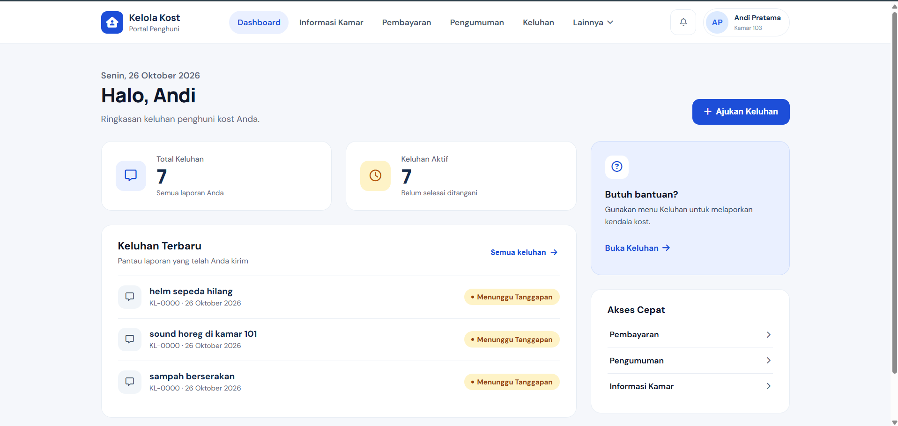
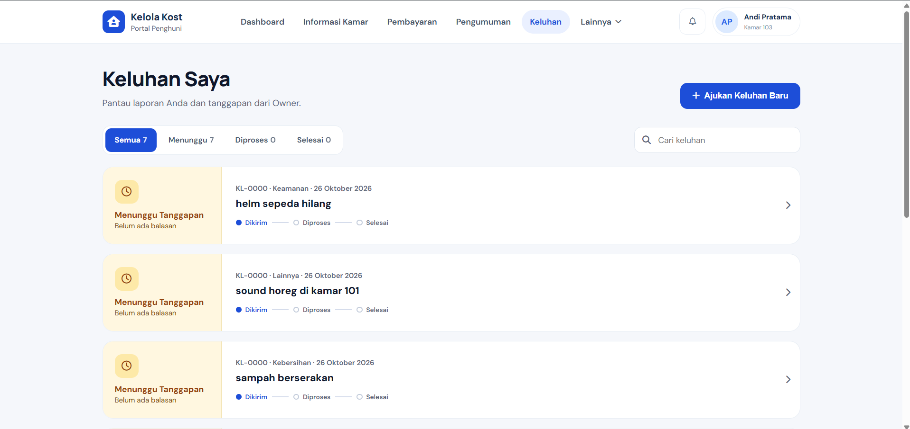
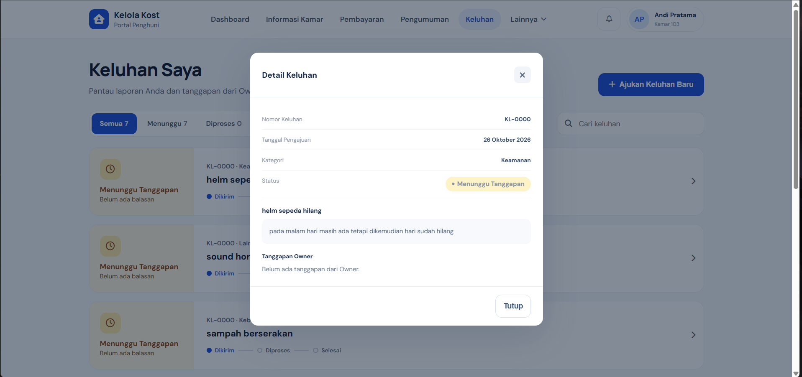
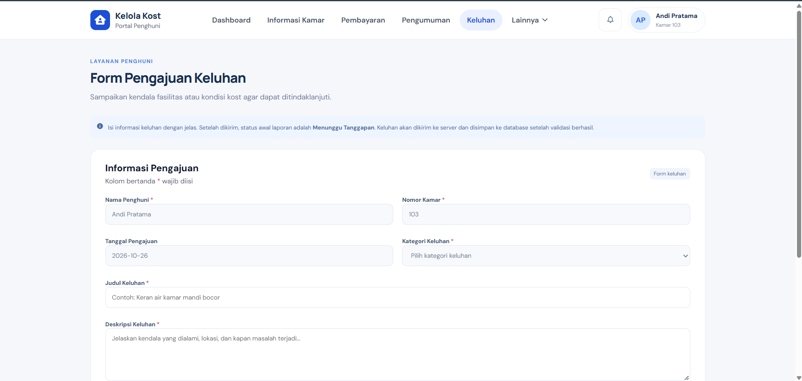

# Website Kelola Kost — Penghuni

Nama    : Aditya Nur Rahman Suwandi
NIM     : 25091397117
Kelas   : 2025C
Kelompok: C04

## Deskripsi
Website UTS Pemrograman Web untuk sisi **Penghuni Kost**, dengan fitur aktif Dashboard, daftar keluhan, dan pengajuan keluhan. Navigasi konten Keluhan dan Form Keluhan dimuat menggunakan AJAX jQuery tanpa memuat ulang seluruh layout.

## Teknologi
- HTML5 dan CSS3 responsif.
- JavaScript dan jQuery untuk interaksi, validasi, serta AJAX.
- PHP 8+ dengan PDO untuk backend.
- MariaDB/MySQL sebagai database.
- Font Awesome dan Google Fonts melalui CDN.

## Fitur yang terhubung ke database
- Dashboard menghitung jumlah keluhan dari MySQL.
- Daftar keluhan membaca data dari tabel `keluhan`, termasuk status dan tanggapan Owner.
- Pencarian, filter status, dan detail keluhan.
- Form pengajuan divalidasi di browser dan di server.
- Pengajuan baru disimpan ke tabel `keluhan` dengan status awal `menunggu`.
- Foto pendukung opsional diunggah ke `uploads/keluhan/` (JPG/JPEG/PNG, maksimal 2 MB).
- Kategori keluhan dan nama file foto disimpan pada kolom tambahan `kategori_keluhan` dan `foto_pendukung`.

## Database dan akun demo
Dump database tersedia di `database/db_kelola_kost.sql`. Database tersebut berisi tabel `users`, `owner`, `kost`, `kamar`, `penghuni`, `keluhan`, `tagihan`, `pembayaran`, `pengumuman`, dan `pengajuan_keluar`.

Versi tugas ini mengakses penghuni demo **Andi Pratama (id_penghuni = 3)**, sesuai data contoh di SQL. Nomor kamar ditampilkan berdasarkan relasi database (kamar 103). Ini hanya identitas demo; autentikasi dan sesi login belum dibuat, jadi jangan gunakan versi ini sebagai sistem produksi.

## Cara menjalankan dengan XAMPP
1. Ekstrak folder `website_kelola_kost` ke `C:\xampp\htdocs\website_kelola_kost`.
2. Buka XAMPP Control Panel, lalu aktifkan **Apache** dan **MySQL**.
3. Buka phpMyAdmin di `http://localhost/phpmyadmin`.
4. Jika membuat database baru, pilih tab **Import**, lalu impor `database/db_kelola_kost.sql`. File tersebut membuat/menggunakan database `db_kelola_kost`.
5. Buka `api/config.php`. Konfigurasi default adalah host `127.0.0.1`, database `db_kelola_kost`, user `root`, dan password kosong. Sesuaikan jika konfigurasi MySQL lokal berbeda.
6. Buka `http://localhost/website_kelola_kost/` di browser. Jangan menjalankan versi PHP ini dengan membuka `index.html` langsung atau menggunakan Live Server saja; gunakan Apache/XAMPP.
7. Coba menu **Keluhan**, lalu ajukan keluhan baru. Periksa tabel `keluhan` di phpMyAdmin untuk memastikan data tersimpan.

## Struktur folder
```text
website_kelola_kost/
├── index.html
├── keluhan.html
├── form-keluhan.html
├── README.md
├── api/
│   ├── config.php
│   └── keluhan.php
├── database/
│   ├── db_kelola_kost.sql
│   └── migration_keluhan.sql
├── css/
│   └── style.css
├── js/
│   ├── main.js
│   ├── keluhan.js
│   └── form-keluhan.js
└── uploads/
    └── keluhan/
```

## Catatan
- Menu Profil Saya, Informasi Kamar, Pembayaran, Riwayat Pembayaran, Pengumuman, dan Berhenti Ngekos masih berupa placeholder.
- API membatasi data ke penghuni demo ID 3. Pada aplikasi nyata, ID penghuni harus diambil dari sesi login yang aman, bukan ditetapkan di kode.

## Dokumentasi Tampilan

### Menu Dashboard


### Menu Keluhan


### Menu Detail Keluhan


### Menu Form Keluhan
